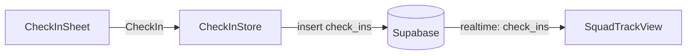

# Raise a PR

A reviewer should understand what a PR does and why from its first line, see how the parts interact without reading the diff, and see every important choice with the options that were turned down. The diff already lists the files; the description explains the change.

## Before you open it

- One logical change per PR. If the top line needs "and", split it. Branch from `main`; never base a PR on another open PR.
- CI checks pass locally, and you have evidence the change works.
- Review placement against `AGENTS.md` (Language practices) for Swift and the `module-structure` skill for TypeScript: pure domain rules, I/O in adapters. Explain any deviation in the PR.
- Title: an imperative summary, prefixed with the work item when there is one, e.g. `Show squad check-ins on the track`. Label `contract` if it touches `ios/Packages/Contracts`, the database schema or the API.
- Open it as a draft, and mark it ready for review once `scripts/verify.sh` passes locally on the head you pushed. CI (`.github/workflows/verify.yml`) runs only on ready PRs and on every push to them after that, so a draft has no CI result. A new screen or a big redesign also gets the `ios-ci` label, so CI's `ios` job runs its UI tests on a Mac and uploads the screenshots before merge; a small UI change is checked on the next scheduled `ios` run on `main` instead, and its owner fixes forward. Merging is in Merging.

## The description

Use `.github/pull_request_template.md`. Sections in this order. Leave out a section only when it truly has nothing to say; never leave out the top line, Verification, Screenshots (for anything users see) or Verifier verdict.

### 1. The top line

The first line of the body, before any heading: one sentence saying what this PR makes possible or changes, in terms of behavior, and why it matters. Keep it sharp and concise. Below it, `Closes #<issue>` when the PR finishes a work item, or `Refs #<issue>` when it only contributes to one.

- Describe the change logically, not as an inventory. Never list files, paths, packages or a feature-by-feature rundown. The diff shows those.
- Name a symbol only when it *is* the change (a renamed interface, a new event).

| ❌ Don't | ✅ Do |
| --- | --- |
| Adds `CheckInSheet.swift`, `CheckInStore.swift`, updates `HomeView.swift` and tests. | You can now check in from the home screen, and your squad sees it on the track right away. |
| This PR implements several features for the recap including podium, excuses and refactoring. | The Sunday recap now names the week's best excuse, so squads have a reason to open it. |

### 2. Why

One to three sentences: the problem and the approach. No commit history, no "as discussed".

### 3. How it works (diagram)

Add a simple diagram when the PR involves a complex interaction between data models, or crosses a boundary: between packages, the app ↔ Supabase, or a change to the check-in or squad lifecycle. Skip it for changes that stay inside one module.

Use a Mermaid block (GitHub renders it in PR descriptions). Keep it small: about 8 nodes or fewer, only the parts this PR touches, and a label on every arrow saying what moves (`inserts check_in`, `realtime: check_ins`, `reads squad.members`). Mark what this PR adds or changes. Explain it in one sentence under the diagram.

````markdown

````

For a state machine change, draw the states and moves that change (`stateDiagram-v2`), not the whole machine.

### 4. Decisions and trade-offs

**Always** include this section when the PR makes a critical technical decision: a new library or service, a data shape other code will depend on, anything in the shared contract, a security or money-handling choice, or anything hard to reverse. Put it in a table:

| Option | Trade-offs | Chosen? |
| --- | --- | --- |
| Supabase Realtime | Live updates with no server of our own; ties us to Supabase | ✅ Fewest moving parts for the MVP |
| Polling every 30 s | Simple, works anywhere; laggy and wastes battery | ❌ The track should feel live |

- List every option you seriously considered, including "do nothing" when it was viable.
- The last column says why the chosen option won, or why each other option lost.
- If the choice needs a human (it changes a `Final` decision, or reviewers disagree), say so here and add the `needs-human` label.

### 5. Scope

What the PR covers and what it deliberately leaves out (follow-ups, known gaps). One to three short items.

### 6. Blast radius

One or two sentences: who or what this touches, and why that's safe or risky.

### 7. Verification

Evidence, not "it compiles": each command you ran and the key line it printed. For behavior a caller sees, run it end to end and say what you observed. If a check couldn't run, write "inconclusive" and why.

### 8. Contract

Tick one box. If the PR changes `ios/Packages/Contracts`, the database schema or the API, label it `contract` and request review from the other owners.

### 9. Screenshots

For a new screen or a big redesign: simulator screenshots or a recording, before and after, from CI's `ios` job on the head (the PR carries the `ios-ci` label; merges and unlabelled PRs use no Mac). A small UI change says which scheduled run on `main` will show it, and its owner checks those screenshots there. Delete the section only when nothing visible changed. Put each next to its entry in the Approved designs collection (an export or capture of the approved board) and list every difference: one the owner agreed to (link where), or one that can't match yet, which the owner hears about before merge. Scene colours from the squad's theme are not differences; take screenshots on the gym theme, the default. Check each image for clipped, cut-off, covered or overlapping content before attaching it; fix it first.

### 10. Verifier verdict

The tier the PR is verified at (see Independent verification) and why, in one line. For tier 2 or 3, a link to the latest verdict comment, which must cover the current diff; until it's posted, say it's pending.

## Independent verification

The author can't pass its own work. A verdict comes from an agent that did not write the change, ran it, and tied what it saw to the exact code it ran. Green CI, the code reviews (Claude's, and Codex's on a bigger PR) and the author re-reading its own diff ("adversarial self-review") are necessary but never the verdict. A verifier earns its time with what CI can't do: looking at the screens, checking the PR's claims, driving the journey and trying the edge case. So how deep it goes depends on what the change can break. The owner picks the tier from the diff and says which and why in the description; the code reviewer may raise it, never lower it, and when in doubt it's the higher one:

- **Tier 1, CI only:** docs and comments, tests only, a copy typo, or a small fix in one file that comes with its test. Green CI is enough: no code review and no verifier.
- **Tier 2, light:** a small UI change, or logic inside one module, touching no contract, schema, auth, privacy, user data or AI. The verifier reads the diff, CI's results and screenshots for the head, and tries one edge case; it doesn't launch the stack unless that edge case needs it.
- **Tier 3, full:** the API or `Contracts`, the database schema or a migration, auth, privacy, user data or AI, a new user flow, or a change across modules. The verifier runs everything below.

Steps 1 to 8 apply to tiers 2 and 3.

1. **Start the verifier when the PR is marked ready, alongside CI.** Don't wait for CI to finish: the verifier does the work that needs no CI first and picks up CI's results and screenshots when they land, so a verdict takes about as long as the slower of the two, not both added up. If CI fails on that head, stop the verifier; a new full run starts on the fixed head, since there is no verdict yet to build on. Batch fixes before asking again. The one review that comes later is Codex's on a bigger PR (see After opening); fixing a Codex finding changes the diff, so it needs a new verdict (step 6). The owner thread starts a new agent (a subagent with no history of the work) and gives it only the task and the diff: the issue or the human's ask in their words, the PR's branch and head commit. Not the author's reasoning, plan or description of what it tested; the verifier forms its own view of what "works" means from the task.
2. **The verifier works in its own clean checkout of that commit**, never the author's working tree, where unpushed edits would be tested but are not in the PR: `git fetch origin '+refs/heads/*:refs/remotes/origin/*' && GIT_NO_REPLACE_OBJECTS=1 GIT_GRAFT_FILE=/nonexistent git worktree add --detach <dir> <full head SHA>` (so local replace refs or grafts can't swap the code checked out), and `git status --porcelain` there prints nothing. It runs the change only in that checkout, with no build caches shared with the author (a fresh `.build/` and DerivedData path), so nothing is replayed from the author's run, and removes it at the end.
3. **The verifier runs the change the way its callers do, and doesn't redo CI.** At tier 3 it follows the `verify-wildcard` skill (`.claude/skills/verify-wildcard/`): launch, check health, drive the affected journey as a squad member would (for anything users see, from the screenshots and UI-test results CI's `ios` job uploads for the head commit), keep the evidence and screenshots, clean up. It reads the real output; tests passing is not proof. The verifier also opens every screenshot and fails the change if anything is clipped, cut off, covered or overlapping. It compares each screen with its approved design in the Approved designs collection and fails any difference the owner didn't agree to (scene colours from the theme excepted). The checks CI runs (`scripts/verify.sh`, `scripts/api-journeys.sh`, the UI tests) count only from CI's own run on that head commit, which the verifier reads and quotes; it doesn't run them again (unless it has a reason to doubt one: it was skipped, or passed only on a retry), and spends its time on what CI can't show: the journeys the diff touches, the evidence at the source, and one thing the author may not have tried. How deep it goes follows the diff: at tier 2 it launches the stack only for the edge case that needs it, and a change with nothing to run (docs, comments or tests whose tier a reviewer raised) is checked by comparing every claim in it with the code and CI's result, without launching the stack.
4. **The verifier reports one verdict:** `PASS`, `PASS+NOTES` (works; the notes are worth the author's attention but don't block) or `FAIL` (doesn't do what the task asks, breaks something else, or couldn't be shown to work). When in doubt it's `FAIL`. The report never contains the Codex mention (see After opening), since it is posted as is.
5. **The owner thread keeps one verdict comment per PR.** It posts the report unedited in this shape, and when a later verdict comes it edits that comment to put the new report on top and the earlier ones below, unchanged:

   ```markdown
   ## Verifier verdict: PASS | PASS+NOTES | FAIL

   Commit: <full head SHA>
   Diff: <output of `git fetch origin '+refs/heads/main:refs/remotes/origin/main' && f=$(mktemp) && git show origin/main:scripts/verify-diff-hash.sh > "$f" && bash "$f" <full head SHA>; rm -f "$f"`>

   What I ran: each command or step, and the key line it printed or what I saw.
   Notes or failures: what's wrong or worth knowing, with the evidence.
   ```

6. **A verdict covers one diff.** A change to the diff after the verdict needs a new verdict from a new verifier. `scripts/verify-diff-hash.sh` names the diff: it hashes the exact content of every file the PR changes, before and after, against its merge base with `main`, so any byte changed gives a new hash and no local git config can change it. Run `main`'s copy, as in the comment above (written to a file first, so a missing script fails loudly instead of printing an empty hash), so the change under test can't alter how it is hashed (a PR that changes the script itself runs its own copy and says so). Merging `main` in keeps the verdict when `main` touched none of the PR's files; otherwise the hash changes and the PR is verified again. On `FAIL`, the author checks every cause the report names (step 7), fixes the real ones, then the loop starts again from step 1. **A re-run checks the delta**, as long as the fix stays inside what the last verdict and reviews named; a fix that reaches past them, or touches the contract or the schema, gets a full run. The new verifier gets the task, the full diff, the previous verdict and the diff between the last verified head and the new one (`git diff <last verified SHA> <new SHA>`, leaving out merges from `main`). It confirms each fix against the report, drives the journeys the delta touches and reads CI on the new head, which reran every check; it doesn't redo journeys the delta can't reach, and names the ones it carried over. Every verdict, `FAIL` included, stays in the comment. A `PASS+NOTES` doesn't call for another run by itself, but fixing a note changes the diff and so needs one: fix the notes that matter in one batch, and answer the rest (step 7). Re-running verifiers on an unchanged diff until one passes doesn't count, with one exception: a `FAIL` caused by the environment (the local stack wouldn't start, a service was down) may be re-run on the same diff once that cause is fixed, and the new verdict says what was fixed. If the author disputes a `FAIL`, a human decides; their written call on the PR stands in for a PASS on that diff.
7. **The owner handles the verdict like a code review** (AGENTS.md, "Review feedback is a symptom"). A note or a failure is a claim to check, not an instruction: confirm it is real and worth its cost before changing anything. Answer every item on the PR, once per verdict and before asking for the next run or a merge: fixed (with the commit), or kept as is and why. A finding with no answer reads as ignored.
8. **Link the latest verdict** from the PR description's Verifier verdict section.

## Writing rules

- Short sentences. Active voice. Plain words.
- Headings (`##`), not bold lead-ins, so sections stand apart.
- No file-by-file lists, commit lists or changelog-style "also updated X" lines.
- Under a minute to read, excluding the diagram and table. If it's longer, cut words or split the PR.

## After opening

If other work in progress is affected, link the PR from its issue. After each merge, merge `main` into your other open PRs, and land small shared PRs first so others build on them. Before removing public code, check the other open branches for users of it.

**Every PR but tier 1 gets a Claude code review first.** A tier 1 PR (docs only, tests only, a typo, or a small fix with its test; see Independent verification) skips it: CI is its check. Otherwise, once the head is green (every CI job passed on it), start a fresh Claude agent that did not write the PR as the reviewer, on Sonnet (`model: "sonnet"`). Give it only the diff, `AGENTS.md` (Code Review Rules) and the skills they point to. It posts one PR comment naming the head commit, with each P0/P1 finding or "No findings", and opens a review thread per finding. One Claude review per head. It is a review, not a verdict: on tier 2 or 3 the verifier still runs. It also checks the tier the description names and raises it when the diff warrants more.

**Bigger PRs also get a Codex review.** Codex is installed on the repo, but Tracy's Codex usage is limited, so ask it only for a feature, an API, contract or schema change, an architecture change, a new dependency or a large refactor; small fixes, docs and test-only changes skip it. Codex doesn't review on its own: post one `@codex review` comment once CI is green on the head and the verifier has passed it (`PASS` or `PASS+NOTES`). **At most two `@codex review` comments per PR, ever:** normally one; a second only when a later head changes the code substantially. Never repeat it for the same commit, and write the mention only in that comment, never in a PR description or other text: Codex reacts to it wherever it appears. Codex is asked last, to save its limited usage, and never holds a merge: if it can't review (it replies that it is out of usage, or no review has landed 30 minutes after the ask), the PR merges without it and says so in one line. Findings that land after the merge are answered in a follow-up PR.

When a review bot or a person comments, read every finding first, then check each is real before acting (AGENTS.md, "Review feedback is a symptom"): fix real ones and reply on the thread with the commit and proof; dismiss the rest with a concrete reason. Re-run the checks, and update Verification if the evidence changed.

## Merging

Tracy's rule (2026-10-23, "why aren't agents merging themselves"): **the owner thread merges its own PR**, every PR, AGENTS.md, `.claude/`, `.github/`, contract and schema PRs included, and never waits for Tracy to merge. It merges when all of these hold on its current head commit:

1. Every check is green: the `verify` workflow passed on the head commit (for a new screen or a big redesign, with its `ios` job run through the `ios-ci` label).
2. For tier 2 or 3, the latest verifier verdict is `PASS` or `PASS+NOTES` (or a human's written call on a disputed `FAIL`), covers the current diff, and each of its notes has an answer on the PR (see Independent verification).
3. For tier 2 or 3, the Claude review is clean on the head commit; on a bigger PR, Codex has reviewed a head of this PR or 30 minutes have passed since the ask (see After opening), and each finding it posted is answered; and no review thread is unresolved.
4. No human has requested changes, and there is no merge conflict.

A change to the rules and checks agents are held to (`AGENTS.md`, `CLAUDE.md`, anything under `.claude/`, `.agents/`, `scripts/` or `.github/`) is tier 2 at least, so an agent other than its author verifies it before merge. Product decisions (a new screen or flow, a vendor, the contract) are still Tracy's to make before they are built (project instructions); once she has decided, the PR that builds it merges like any other. Only a PR Tracy labels `needs-human` waits for her. For every PR users can see, the owner thread posts the screenshots or recording in the thread when it merges.

Branch protection on `main` is to require the `verify` check and block force-pushes and deletion (issue #2; Tracy turns it on, since the agent proxy can't change branch settings); until then GitHub enforces none of this. It can't require an approval, because agents open PRs under Tracy's account and GitHub doesn't let an author approve their own PR, so the rest holds because every agent follows it. Use a merge commit (GitHub's "Create a merge commit"), then say in the owner thread that it merged.
